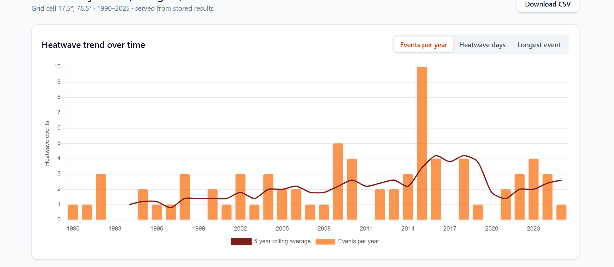
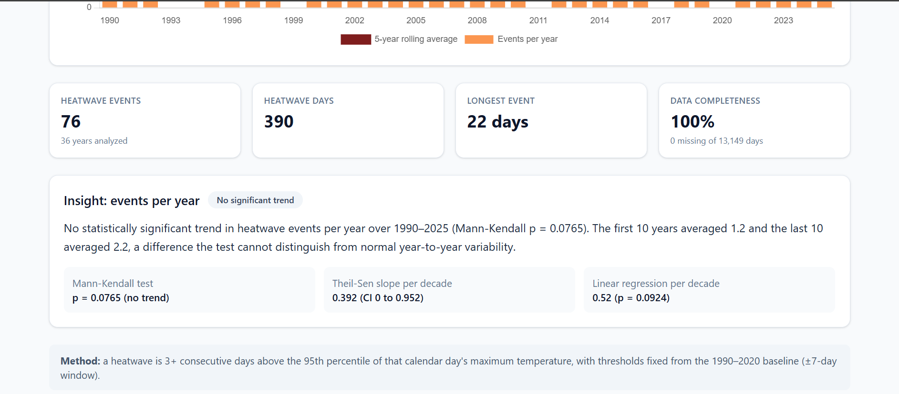
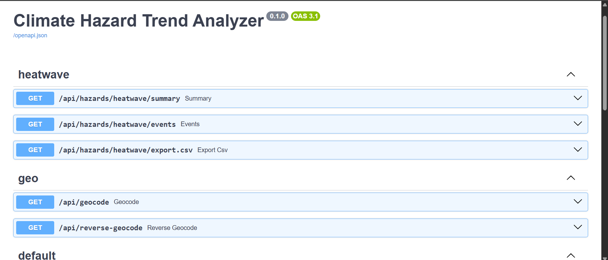
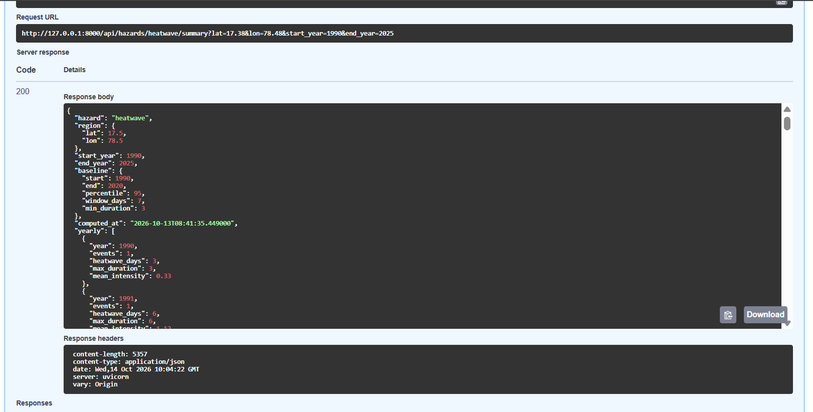

# Climate Hazard Trend Analyzer

A web app that analyzes historical weather data and shows how **heatwaves** have changed over time for a chosen location. Built as a case study for the Full-Stack Developer role at Dygnify Ventures.

- **Live app:** TODO
- **API docs (Swagger): TODO


## Screenshots




## Features

- City search, map click selection (with place-name lookup) or manual latitude/longitude
- Heatwave as the default (and currently only) hazard, with a year-range selector
- Heatwave detection with a calendar-day 95th-percentile definition
- Interactive charts: events per year, heatwave days, longest event, each with a 5-year rolling average
- Plain-language insights that state clearly when the evidence is weak
- Data-quality reporting (missing days, completeness)
- Raw weather data and computed results cached in MongoDB
- Input validation, rate limiting and a CORS allow-list
- CSV export of the yearly results

**Bonus items completed:** Leaflet map selection, CSV export, Mann-Kendall trend test.

## Tech stack

| Layer | Technology |
|---|---|
| Frontend | React (Vite, JSX), Tailwind CSS, Chart.js, Leaflet |
| Backend | Python, FastAPI, Motor (async MongoDB), pandas, NumPy, SciPy, pymannkendall, slowapi |
| Database | MongoDB (local for development, Atlas in deployment) |
| Data source | Open-Meteo Historical Weather API |

## Architecture

```
React (Vite)  --->  FastAPI  --->  MongoDB
                        |            - daily_tmax      (raw cached weather, one document per location-year)
                        |            - hazard_results  (computed analysis, one document per request key)
                        v
                  Open-Meteo API (called only for years not yet cached)
```

Request flow for `GET /api/hazards/heatwave/summary`:

1. Validate the query parameters and snap coordinates to a 0.25° grid.
2. Look for a stored result in `hazard_results`. If found, return it.
3. Otherwise load daily data from `daily_tmax`, fetching any missing years from Open-Meteo in one request.
4. Detect heatwaves and compute trends in a worker thread, so the event loop is not blocked.
5. Store the result in `hazard_results` and return it.

Stored results are keyed with an `ALGO_VERSION`, so changing the hazard logic never serves stale results.

### Project structure

```
backend/app/
  main.py                    app setup, CORS, rate limiting, index creation
  db.py                      Mongo client
  schemas.py                 validated query parameters
  rate_limit.py              slowapi limiter
  routers/hazards.py         heatwave endpoints and CSV export
  routers/geo.py             city search and reverse geocoding
  services/openmeteo.py      upstream fetch with timeouts and retries
  services/weather_store.py  raw-data cache (per location-year)
  services/heatwave.py       percentile thresholds and event detection
  services/trends.py         Mann-Kendall, Theil-Sen, regression, insight text
  services/analysis.py       orchestration and stored results
frontend/src/
  App.jsx, api.js
  components/RegionPicker.jsx, MapPicker.jsx, Charts.jsx, InsightCards.jsx
```

## Data source

**Open-Meteo Historical Weather API** (`temperature_2m_max`, daily, °C). It needs no API key, covers 1940 onward, and returns modelled data for any coordinate. It is reanalysis data on a grid, not station observations (see Limitations).

## Hazard logic: heatwaves

**Definition:** 3 or more consecutive days on which the daily maximum temperature exceeds the 95th percentile for that calendar day.

- **Calendar-day thresholds.** A separate threshold is computed for each day of the year (for example one for 15 May and another for 1 January). A single yearly percentile would place every "heatwave" in summer and ignore unusual heat in other seasons.
- **±7 day window.** One calendar day has only 31 samples in a 31-year baseline, which is too few for a stable 95th percentile. Pooling a ±7 day window gives about 465 samples per threshold.
- **Fixed baseline (1990–2020).** Thresholds always come from this period, whatever range the user selects. Computing them from the analysis window itself would force about 5% of days to be "hot" in every window and bias the trend.
- **Leap days.** 29 February is folded into 28 February so calendar days line up across years.
- **Events are attributed to the year they start in**, so a heatwave spanning 31 December to 2 January is counted once.
- **Per-year metrics:** number of events, total heatwave days, longest event (days) and mean intensity (average degrees above the threshold).

## Trend analysis

Each yearly metric (events, heatwave days, longest event) is tested with:

- **Mann-Kendall** (primary test): non-parametric, suitable for count data with many zero years.
- **Theil-Sen slope** with a confidence interval: robust to outlier years.
- **Linear regression (OLS):** shown for comparison.
- A 5-year trailing rolling average for the charts.

Insights are written honestly:

- A trend is called significant only when Mann-Kendall p < 0.05.
- When the regression test disagrees, or the slope's confidence interval includes zero, the text says the evidence is moderate, not strong.
- The text flags when a single year dominates the total.
- Percentage changes are reported only for significant trends, because percentages from a small base mislead.

### Example finding: Hyderabad, 1990–2025

- Heatwave events per year and longest event: no statistically significant trend (Mann-Kendall p = 0.077 and 0.27).
- Heatwave days per year: Mann-Kendall reports an increase (p = 0.033), but the app labels the evidence as moderate: linear regression is not significant (p = 0.086), the Theil-Sen interval includes zero, and 2015 alone contributes 18% of all heatwave days.

## Data handling

- **Missing values** are kept as missing, never filled. A missing day breaks a heatwave run, which is conservative: the app never invents heatwave days.
- **Outliers:** values outside physical bounds (below -90 °C or above 60 °C) are set to missing.
- **Units:** temperatures are requested in °C explicitly.
- **Completeness** (days analyzed, missing days, percentage) is returned with every result and shown in the UI.
- **Incomplete years:** only completed years can be requested, so a partial current year is never cached.
- **Caching:** one document per location-year in `daily_tmax`, so only missing years are fetched. Upstream calls use timeouts and retry with exponential backoff.

## API

| Endpoint | Description |
|---|---|
| `GET /api/health` | Service and database check |
| `GET /api/hazards/heatwave/summary` | Yearly metrics, trends, insights, data quality, thresholds |
| `GET /api/hazards/heatwave/events` | List of individual heatwave events |
| `GET /api/hazards/heatwave/export.csv` | Yearly results as CSV |
| `GET /api/geocode?q=` | City search (Open-Meteo geocoding) |
| `GET /api/reverse-geocode?lat=&lon=` | Place name for a map point (OpenStreetMap Nominatim) |

Parameters for the hazard endpoints: `lat` (-90 to 90), `lon` (-180 to 180), `start_year` (1990 or later), `end_year` (up to the last completed year). The range must cover at least 10 years.

Example:

```
GET /api/hazards/heatwave/summary?lat=17.38&lon=78.48&start_year=1990&end_year=2025
```
```json
{
  "hazard": "heatwave",
  "region": { "lat": 17.5, "lon": 78.5 },
  "start_year": 1990,
  "end_year": 2025,
  "yearly": [{ "year": 1990, "events": 1, "heatwave_days": 3, "max_duration": 3, "mean_intensity": 0.33 }],
  "trends": { "events": { "stats": {}, "rolling_5yr": [], "insight": "..." } },
  "quality": { "days": 13149, "missing_days": 0, "completeness_pct": 100 },
  "cached": true
}
```

## Security and performance

- Query parameters are validated with explicit ranges; invalid input returns 422.
- Per-IP rate limiting with slowapi, with tighter limits on endpoints that can trigger upstream calls. Exceeding a limit returns 429.
- CORS is restricted to configured origins and to GET requests.
- Search text is length-limited and always passed as a parameter, never concatenated into an upstream URL.
- Coordinates are snapped to a 0.25° grid, which prevents filling the cache with near-duplicate locations.
- Secrets live in environment variables. `.env` is git-ignored and `.env.example` is committed.
- Stored results make repeat requests fast, and the CPU-heavy analysis runs off the event loop.

## Setup

**Prerequisites:** Python 3.12+ (developed on 3.14), Node 20+, and MongoDB running locally (or an Atlas connection string).

**Backend**
```bash
cd backend
python -m venv .venv
.venv\Scripts\activate          # Windows (macOS/Linux: source .venv/bin/activate)
pip install -r requirements.txt
cp .env.example .env            # Windows PowerShell: Copy-Item .env.example .env
uvicorn app.main:app --reload --reload-dir app
```
Open http://127.0.0.1:8000/docs

`backend/.env`:
```
MONGODB_URI=mongodb://localhost:27017
DB_NAME=climate
CORS_ORIGINS=http://localhost:5173
```

**Frontend**
```bash
cd frontend
npm install
cp .env.example .env            # Windows PowerShell: Copy-Item .env.example .env
npm run dev
```
Open http://localhost:5173

`frontend/.env`:
```
VITE_API_URL=http://127.0.0.1:8000
```

## Deployment

- **Frontend:** Vercel (root directory `frontend`)
- **Backend:** Render free web service (root directory `backend`)
- **Database:** MongoDB Atlas (free tier)

| Variable | Where | Purpose |
|---|---|---|
| `MONGODB_URI` | backend | Mongo connection string |
| `DB_NAME` | backend | Database name (`climate`) |
| `CORS_ORIGINS` | backend | Comma-separated allowed frontend origins |
| `VITE_API_URL` | frontend | Backend base URL |

**Note:** TODO (after deploying) The free Render instance sleeps after inactivity, so the first request can take about a minute. Some popular cities were pre-computed so they respond immediately. A new location is slower on first use, because it downloads and processes decades of data.

## Assumptions

- Heatwave is defined purely relative to each calendar day's 95th percentile, as in the brief. A "heatwave" can therefore occur on days that are not hot in absolute terms (for example a 32 °C spell in January). An optional minimum absolute temperature would be a sensible extension.
- A location is represented by its 0.25° grid cell.
- Yearly values are treated as independent in the trend tests.
- Analysis starts in 1990 to match the fixed baseline, and the current (incomplete) year is excluded.
- Only heatwaves are implemented (the brief allows this).

## Limitations

- Open-Meteo values are modelled grid-cell data, not station measurements, so they can differ from a local weather station.
- One grid cell does not describe a whole region.
- No correction for autocorrelation, or for testing three metrics at once.
- Baseline years (1990–2020) are also part of the analysis window, so only years after 2020 are a fully independent check.
- Rate limiting and the reverse-geocode cache are in memory, so they reset on restart and are not shared between instances.
- The public Nominatim service is intended for light use only.
- Atlas accepts connections from any IP because the free Render tier has no fixed IP, so access relies on a strong database password.
- Free hosting limits apply: cold starts and low CPU on the first request.

## What I would improve with more time

- Add droughts and heavy-rainfall hazards using the same pipeline.
- Support bounding-box regions by aggregating grid cells.
- Add an optional absolute temperature floor to the heatwave definition.
- Validate against station data (for example IMD) and compare with other datasets.
- Correct for autocorrelation (for example a modified Mann-Kendall test).
- Add automated tests (threshold computation, event detection edge cases, validation) and CI.
- Move rate limiting and caches to Redis, and run large first-time computations as background jobs.
- Add PDF export.
- Use a self-hosted or paid geocoder.

## AI tools used

TODO: edit so it is accurate. Example: I used Claude (Anthropic) as a pair-programming assistant to plan the architecture, draft the FastAPI, analysis and React code, review the statistical choices, and debug setup and deployment problems. I typed, ran and tested the code myself and can explain every part of it.

## Credits

- Weather data: [Open-Meteo.com](https://open-meteo.com/) (CC BY 4.0)
- Geocoding: Open-Meteo Geocoding API, and OpenStreetMap Nominatim for reverse geocoding
- Map tiles and data: © OpenStreetMap contributors